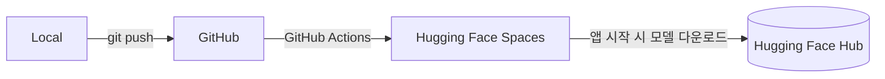

<div align="center">

# Emotion Diary

**일기 속 감정을 읽고, 지금 필요한 영화·음악·책을 건네는 AI 감성 비서**

[](https://huggingface.co/spaces/taehoon222/emotion-chatbot-app)


[**Live Demo**](https://huggingface.co/spaces/taehoon222/emotion-chatbot-app) · [개발 과정](DEVELOPMENT.md)

</div>

---

## Overview

하루를 마무리하며 쓴 일기를 `klue/roberta-base` 기반 모델이 분석해 감정을 분류하고,
그 감정에 **몰입하고 싶을 때(수용)** 또는 **기분을 바꾸고 싶을 때(전환)** 에 맞는 콘텐츠를 추천합니다.

## Features

| | 기능 | 설명 |
| :-: | :-- | :-- |
| 🧠 | **감정 분석** | `klue/roberta-base`를 파인튜닝해 일기 속 복합적인 감정을 분류합니다. (Accuracy 0.79) |
| 🎭 | **수용 / 전환 큐레이션** | 분석된 감정에 따라 영화·음악·책을 두 가지 시나리오로 추천합니다. |
| 📔 | **감정 달력** | 일기와 분석 결과를 달력으로 모아 과거의 감정 흐름을 돌아볼 수 있습니다. |
| 🎨 | **커스텀 테마** | 색상과 배경 이미지를 바꿔 나만의 분위기를 만들 수 있습니다. |
| 📱 | **반응형 UI** | Flask + JavaScript로 만든 가볍고 직관적인 인터페이스입니다. |

## Tech Stack

| 영역 | 기술 |
| :-- | :-- |
| **Backend** | Python · Flask · Gunicorn · SQLAlchemy |
| **Frontend** | HTML · CSS · JavaScript (Jinja2) |
| **AI / Data** | PyTorch · Hugging Face Transformers · Scikit-learn · Pandas |
| **Database** | Supabase (PostgreSQL) |
| **DevOps** | Docker · GitHub Actions · Hugging Face Spaces · Git LFS |

## Architecture

가벼운 앱 코드와 무거운 AI 모델을 분리해, 코드만 push해도 빠르게 배포되도록 구성했습니다.



## Model Performance

| Metric | Score |
| :-- | --: |
| Accuracy | 0.7905 |
| F1 Score | 0.7910 |
| Loss | 0.6943 |

## Quick Start

**Requirements:** Python 3.10

```bash
# 1. 클론
git clone https://github.com/kootaeng2/Emotion-Chatbot-App.git
cd Emotion-Chatbot-App

# 2. 가상환경 (conda 예시)
conda create -n emotion_env python=3.10
conda activate emotion_env

# 3. 의존성 설치
pip install -r requirements.txt

# 4. 환경 변수 (추천 기능에 Gemini API 사용)
echo 'GEMINI_API_KEY="YOUR_GEMINI_API_KEY"' > .env

# 5. 실행
python run.py
```

실행 후 http://127.0.0.1:5000 에 접속하세요.

## Project Structure

```
.
├── .github/workflows/   # CI/CD (Hugging Face Spaces 배포)
├── notebooks/           # 데이터 탐색·전처리
├── scripts/             # 모델 학습·평가 스크립트
├── src/
│   ├── __init__.py      # Flask 앱 팩토리
│   ├── auth.py          # 인증
│   ├── emotion_engine.py# 감정 분석 모델 로딩·예측
│   ├── recommender.py   # 콘텐츠 추천
│   ├── main.py          # 메인 페이지·일기 기능
│   ├── models.py        # DB 모델
│   └── templates/       # Jinja2 템플릿 + static(CSS/JS)
├── supabase/            # DB 마이그레이션
├── Dockerfile
├── requirements.txt
└── run.py
```

<details>
<summary><b>Frontend 구조 자세히 보기</b></summary>

<br>

`src/templates`는 Jinja2 템플릿 상속과 매크로로 UI를 구성합니다.

- **레이아웃** `base.html`, `base_auth.html` — 공통 뼈대(내비게이션 등)
- **페이지** `main.html`, `diary.html`, `page.html`, `login.html`, `signup.html` — 레이아웃을 상속
- **컴포넌트** `_macros.html` — 로그인 폼, 추천 탭 같은 반복 UI를 매크로로 분리
- **정적 파일** `static/css`, `static/js` — 페이지별 스타일, API 통신·달력·테마 로직

</details>

## Development Notes

개발 중 겪은 기술적 문제와 해결 과정은 [DEVELOPMENT.md](DEVELOPMENT.md)에 정리했습니다.

## License

MIT License
